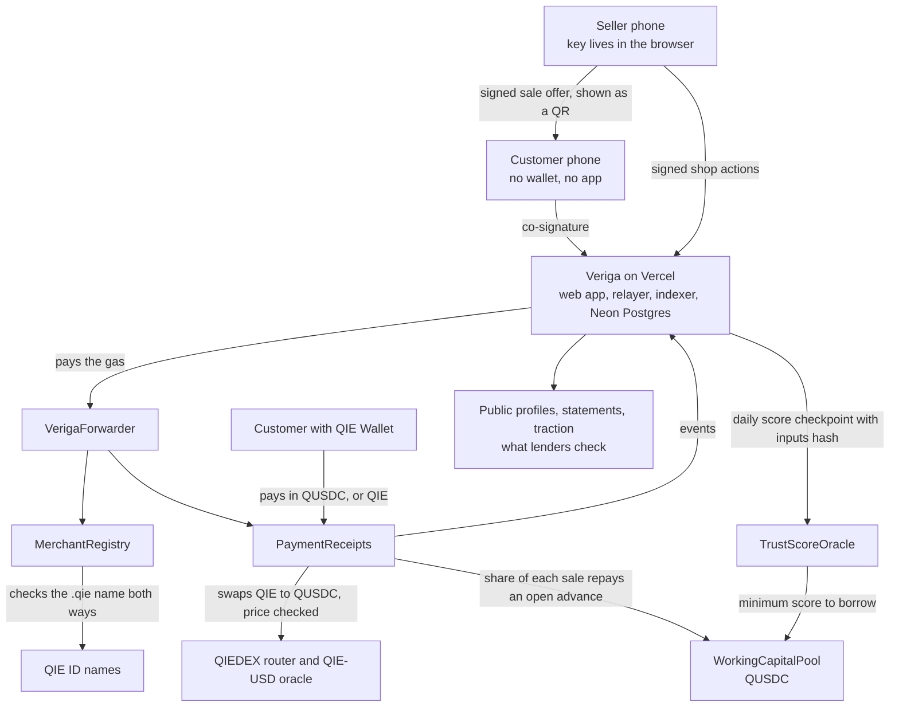
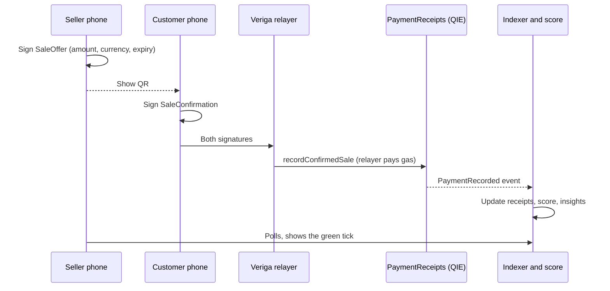

<p align="center">
  
</p>

<h3 align="center">Every sale becomes credit.</h3>

<p align="center">
  Customer-confirmed sales records and self-repaying working capital for small merchants, live on QIE mainnet.<br/>
  QIE Mainnet Hackathon 3.0, Commerce and Real World track.
</p>

<p align="center">
  <a href="https://veriga.xyz"><b>Open the app</b></a> ·
  <a href="https://veriga.xyz/try"><b>Try it in 3 minutes</b></a> ·
  <a href="https://veriga.xyz/traction">Live traction</a> ·
  <a href="https://veriga.xyz/developers">Developers</a>
</p>

---

## Judges: try it in 3 minutes

You don't need a wallet, crypto or an account. Everything below happens on QIE mainnet.

| Step | What to do | What you should see |
|---|---|---|
| 1. Open a shop (30 sec) | Go to [/onboard](https://veriga.xyz/onboard), pick **Use this phone**, type any shop name, tap **Open my shop**. | The Sell screen. Your shop was registered on-chain and Veriga paid the gas. |
| 2. Record a cash sale (45 sec) | Type an amount (switch to NGN if you like) and tap **Show confirmation QR**. Scan it with a second phone, or on one device tap **Testing on one phone? Open the customer screen here**. | The customer screen asks "Did you pay?" |
| 3. Confirm as the customer (20 sec) | Tap **Yes, I paid** (or **Confirm as a test customer** on the same device). | A green tick on the Sell screen and a link to the transaction. |
| 4. See what a lender sees (30 sec) | Open **Home**, then **Public profile**. Tap **Run the check in my browser**. | The score breakdown, every receipt, and the score fingerprint recomputed in your browser. |
| 5. Watch credit repay itself (30 sec) | Open the [demo shop](https://veriga.xyz/m/0xAe7222B4FE93C24D655c85aebC588A44E93f134b). | An advance that was closed by an automatic payment inside a customer's sale. |
| 6. Check the pool (15 sec) | Open the [lending pool](https://veriga.xyz/dashboard/pool). | Live totals and rules read straight from the contract. |

The same tour is in the app at [/try](https://veriga.xyz/try).

## The problem

Walk through any market and you'll find shops that have sold to the same customers for years. Ask one of them for a loan and the answer is usually no. The business is fine. The problem is that nobody can see it. Most of those sales are cash, written in a notebook if they're written at all, and banks can't read a notebook.

Crypto payment apps don't fix this, because they need the customer to already hold crypto. Most customers don't.

## What Veriga does

1. **The seller types the amount** in their own currency and shows a QR code. Their phone signs a one-time sale offer, offline if it has to.
2. **The customer scans it and taps "Yes, I paid".** No app, no wallet, no fee. Their phone co-signs the receipt and Veriga's relayer records it on QIE.
3. **Customers with crypto pay directly** in QUSDC, or in QIE that swaps to QUSDC through QIEDEX in the same transaction, checked against the QIE Oracle.
4. **Every receipt feeds an open trust score.** On-chain sales weigh most. Cash sales count less and are capped per customer, so fake customers buy very little.
5. **The score unlocks working capital.** Advances are sized from settled on-chain sales only. While one is open, the contract sends a share of every new sale back to the pool automatically. Each loan repaid on time doubles the next limit. Defaults are public.
6. **Anyone can lend.** Lenders deposit QUSDC into the LenderVault, earn the fees shops pay, and withdraw whenever the money isn't out with shops. The vault is the pool's only admin, so nobody but a lender can move lender money, not even the team.
7. **Lenders check it all themselves.** Every shop has a public profile under its `.qie` name, a score anyone can recompute from chain data, and statements in CSV and ISO 20022 camt.053.

## Proof on mainnet

Every link below opens the QIE explorer.

| What happened | Transaction |
|---|---|
| A seller opened a shop with no wallet and no gas (ERC-2771 forwarder) | [0x838d…4f07](https://mainnet.qie.digital/tx/0x838d426b6a28c1555f3ee85a0d30480de3e5e724bb87e93464b9d91bb5344f07) |
| A cash sale co-signed by the customer's phone | [0x8752…2124](https://mainnet.qie.digital/tx/0x875296df4e429feaf152b14206899d73e543c4c79f3f2afeb26eb318c2c74124) |
| A customer paid in QUSDC | [0x82dd…9328](https://mainnet.qie.digital/tx/0x82dd508f3c8f638bdab797d61c2820b398e87ff260f3e4369dd13637f27a9328) |
| A trust score checkpointed on-chain with its inputs hash | [0xc4d7…6f44](https://mainnet.qie.digital/tx/0xc4d729ebbb4dd918e1d49847e9a2238799d501e86778fb4bab2def87249d6f44) |
| The pool was funded with QUSDC | [0x2cf2…c74a](https://mainnet.qie.digital/tx/0x2cf2045e1cdcc87cca6918652c67cf1a149a7d2b8a4d9a49ebe0772a4809c74a) |
| The demo shop took a working-capital advance | [0xffc6…914c](https://mainnet.qie.digital/tx/0xffc6398a49cefb5247a5ea81226eb21a0ae5e6c9d22e30aca4670bc44144914c) |
| Its next sale repaid the advance in the same transaction (`AdvanceRepaid`, `AdvanceClosed`) | [0x540a…074a](https://mainnet.qie.digital/tx/0x540a9d26d0729542678db1bc69213bcc85557c5cc931c4632f0f12d249ba074a) |
| The pool's admin role moved to the LenderVault | [0x611e…4665](https://mainnet.qie.digital/tx/0x611e6087040f4e062176b2b361a81759f132350aafe385faf585f636ba4f4665) |
| The team wallet gave up its pool admin role for good | [0xc9af…72b1](https://mainnet.qie.digital/tx/0xc9affedfa3b2e200f3ef8b0456cc64e17497b395ce712281c16829c22a6872b1) |

The pool runs with small demo limits for now (a $1 first advance) so the whole credit cycle could be shown with real money at almost no cost. The contract's hard limits are in the [lending rules](https://veriga.xyz/dashboard/pool).

### Contracts (QIE mainnet, chain 1990, all six source-verified)

| Contract | Address | Job |
|---|---|---|
| MerchantRegistry | [0x6005A1e73A6cCd2759eC5bC9f74F80997393cc22](https://mainnet.qie.digital/address/0x6005A1e73A6cCd2759eC5bC9f74F80997393cc22) | Shops, profiles, QIE Pass attestations, verified `.qie` names |
| PaymentReceipts | [0x4e1A43B27F83532d1547C64b353Cb23CDd7A490E](https://mainnet.qie.digital/address/0x4e1A43B27F83532d1547C64b353Cb23CDd7A490E) | Settled and confirmed sales, soulbound receipts, `payWithQIE`, auto-repayment |
| WorkingCapitalPool | [0xbeb5d332a5C6dDeb117f3cC47fAb74F41f8A4ECA](https://mainnet.qie.digital/address/0xbeb5d332a5C6dDeb117f3cC47fAb74F41f8A4ECA) | Settled volume, credit ladder, advances, defaults |
| TrustScoreOracle | [0x857c34aCcD229E270b9790dfB6647D6a5fC9BE81](https://mainnet.qie.digital/address/0x857c34aCcD229E270b9790dfB6647D6a5fC9BE81) | Score checkpoints with a canonical inputs hash |
| VerigaForwarder | [0x6F859A4FC901873a85b8691D25A941A3fe605DBF](https://mainnet.qie.digital/address/0x6F859A4FC901873a85b8691D25A941A3fe605DBF) | ERC-2771 forwarder for gas-free merchant actions |
| LenderVault | [0x9bDDd37A74B26DEE53Ab1911a171Dc51ecefc647](https://mainnet.qie.digital/address/0x9bDDd37A74B26DEE53Ab1911a171Dc51ecefc647) | Anyone lends QUSDC to shops (ERC-4626). The pool's only admin, so only lenders can move lender money |

## Two kinds of evidence, labeled honestly

| | Settled | Customer-confirmed |
|---|---|---|
| What happened | Money moved on-chain (QUSDC, or QIE swapped through QIEDEX) | Cash or bank transfer, co-signed by the customer's phone |
| Counts toward the trust score | Fully | Partly, capped at 3 sales and $200 per sale per customer per week |
| Counts toward the borrowing limit | Yes | Never |
| In the camt.053 statement | Booked credit | Information-only entry |

That third row is the important one. A dishonest merchant can invent customer keys, so cash sales are never allowed to raise how much anyone can borrow.

## How it fits together



A sale, step by step:



## QIE integrations

| Component | How Veriga uses it |
|---|---|
| QIE mainnet (chain 1990) | All six contracts and every receipt |
| QUSDC | Unit of account, settlement and lending |
| QIEDEX router | `payWithQIE` swaps native QIE to exact QUSDC inside the payment transaction |
| QIE Oracle (QIE/USD) | Caps the swap price at 3% over oracle and refuses stale data |
| QIE ID | Shops link a `.qie` name, checked on-chain through both the forward registry and the reverse resolver. Pay links work as `/pay/name.qie` |
| QIE Wallet | Connects through EIP-6963 for shop owners and paying customers |
| ISO 20022 | Statements export as camt.053.001.08, a format banks already process |
| QIE Pass | The registry stores a Pass attestation and profiles show the badge. Turning on live checks needs partner API keys, which we're waiting on |

`payWithQIE` and the `.qie` name link are tested against a fork of live QIE mainnet, using the real QIEDEX pool, oracle and name registry.

## What a shop gets

- **Sell screen** that works in naira, cedis, shillings, rand or dollars, with cash and crypto modes.
- **One-phone testing**, so a new seller can see the whole flow before asking a customer.
- **Dashboard** with sales, customers, a trust score and a weekly summary worked out from recorded sales only (no AI guesses).
- **Capital page** showing what unlocks the next advance and how repayment works.
- **Statements** as CSV and ISO 20022 camt.053, plus a public profile lenders can check.
- **Printable shop poster** with a QR code customers scan to pay or check the shop.
- **Installable app** (PWA) that opens straight to the Sell screen.
- **Five languages**: English, Nigerian Pidgin, Yoruba, Igbo and Hausa on the screens sellers and customers use most.
- **Lend to shops** page where anyone lends QUSDC from their wallet, sees what their share is worth, withdraws, and reads the full loan book.
- **Pool admin page** where the vault owner pauses new advances or proposes new rules, which wait a day on-chain before anyone can apply them. Everyone else sees it read-only.

## Repository layout

```
contracts/          Solidity 0.8.20, OpenZeppelin 5, berlin EVM target
  contracts/          the six contracts above, plus QIE interfaces and test mocks
  scripts/            deploy, verify, export ABIs, mainnet demo of the credit cycle
  test/               unit tests and mainnet fork tests

apps/indexer/       Express, Prisma, viem (served by the web app at /api)
  src/poller          reads every contract event in chain order
  src/sync            catch-up sync on reads, with a database lease
  src/trust/          the open score formula and its canonical inputs hash
  src/statements/     CSV and ISO 20022 camt.053 builders
  src/insights/       weekly summaries from recorded sales
  src/relayer/        sponsors gas for signed requests, with an allowlist and rate limits
  src/routes/         public JSON API, traction and FX

apps/web/           Next.js 14, wagmi, viem, Tailwind, Framer Motion
  marketing pages     landing, try, how it works, merchants, lenders, pricing, security, developers, FAQ, about
  shop app            home, sell, sales, capital, statements, receipts, poster, lending pool, settings
  customer pages      one-tap confirm, pay, receipt, my receipts
  public proof        shop profiles with in-browser score checks, directory, live traction

packages/shared/    ABIs generated from the contracts, chain config, QIE addresses
```

## Running it locally

```bash
npm install

# Contracts: unit tests, then the same flow against a fork of live QIE mainnet
cd contracts
npx hardhat test
FORK_MAINNET=1 npx hardhat test test/fork.mainnet.test.ts

# Full rehearsal on a local mainnet fork
FORK_MAINNET=1 npx hardhat node                       # terminal 1
npx hardhat run scripts/deploy.ts --network localFork  # terminal 2
node scripts/export-abis.mjs

# Indexer tests (SQLite, no setup needed)
cd ../apps/indexer
npm test

# Web app with the API built in (copy .env.example to .env.local)
cd ../web
npm run dev      # on :3000, API at :3000/api
```

## Deploying

```bash
cd contracts
npx hardhat run scripts/deploy.ts --network qieMainnet   # needs a funded DEPLOYER_PRIVATE_KEY
npx hardhat run scripts/verify.ts --network qieMainnet   # source verification on mainnet.qie.digital
```

The deploy script writes every address and constructor argument to `contracts/deployments/qieMainnet.json`. The web app deploys to Vercel's free tier with a Neon Postgres database. The schema is pushed during the build, and a daily cron syncs events, checkpoints scores and writes Monday summaries. The relayer wallet needs a small QIE balance for gas, and the pool needs QUSDC before any advance can be issued.

## Tests

- **53 contract tests**: lender vault deposits, withdrawals, default write-downs, the one-day rule delay and owner limits, plus settlement, `payWithQIE` with the oracle bound, confirmed and one-tap sales, the gas-free forwarder, settled-volume accounting, per-customer caps, the credit ladder, auto-repayment, defaults and admin limits.
- **2 fork tests** against live QIE mainnet: a real QIE to QUSDC payment through QIEDEX within the oracle bound, and linking a real `.qie` name from QIE ID. They run with `FORK_MAINNET=1`.
- **86 indexer tests**: score formula, canonical hashing, event handling, statements, insights, traction filtering, relayer policy and the API.
- **Live runs on mainnet**: gas-free signup, customer-confirmed sales, QUSDC payments, score checkpoints and a full advance that repaid itself (see [Proof on mainnet](#proof-on-mainnet)).

## Security notes

The contracts guarantee that nobody can record a cash sale alone, that the relayer can't act without a signature, that receipts can't move, that QIE swaps stay within the oracle bound, and that the pool admin can't push terms past hard limits or touch lent funds.

The known limits are written down too. Customer keys can be invented, which is why cash sales are capped and never count toward borrowing. Merchants can sell off-platform, which is why first limits are small and defaults are public. The score updater is a trusted role, so every checkpoint carries an inputs hash anyone can recompute. QUSDC has an issuer. The full list is on the [Security page](https://veriga.xyz/security). Veriga hasn't had an external audit yet.

## How traction is counted

The [traction page](https://veriga.xyz/traction) and [API](https://veriga.xyz/api/traction) count only organic activity. Team and test wallets listed in `TEAM_WALLETS`, merchants paying themselves, and payments where the payer is itself a registered merchant are left out and shown separately.

## License

MIT
